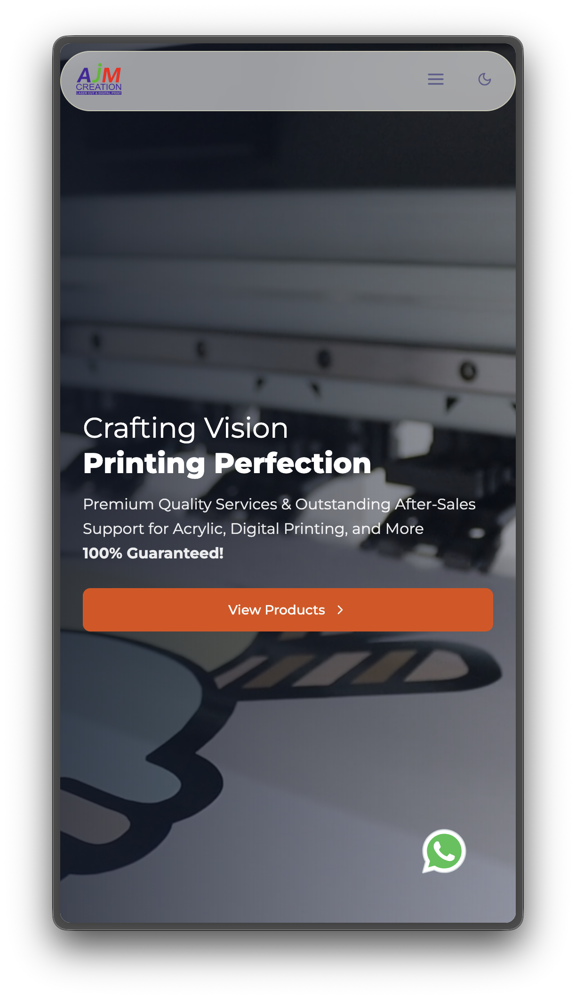
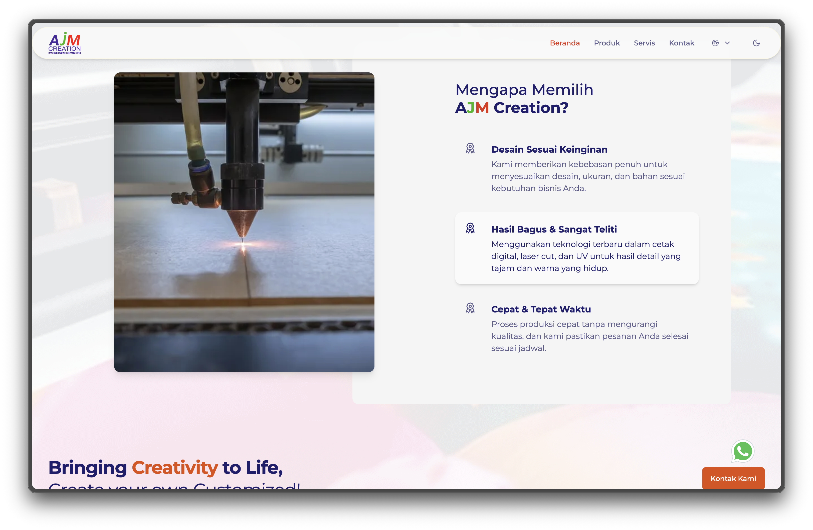

## Overview  
AJM Creation is a creative production company, and their website needed to feel modern, bold, and dynamic. I handled the overall development—from UI/UX decisions to building an interactive background, polishing the layout, and making sure it works great on both desktop and mobile.

## Tech Stack  
- Astro + React  
- TailwindCSS  
- Custom interactive background (JS + CSS)  

## Key Features  
- Interactive gradient + particle background  
- Light and dark mode variations  
- Smooth mobile-first responsiveness  
- Clean and strong typography for better readability  

## My Role  
- Full front-end development  
- Designed and implemented the interactive background  
- Handled responsiveness and layout structure  
- Optimized assets and overall performance  
- Managed deployment and final polishing  

## Live Website  
[Visit AJM Creation Website](https://www.ajmcreation.id/)
